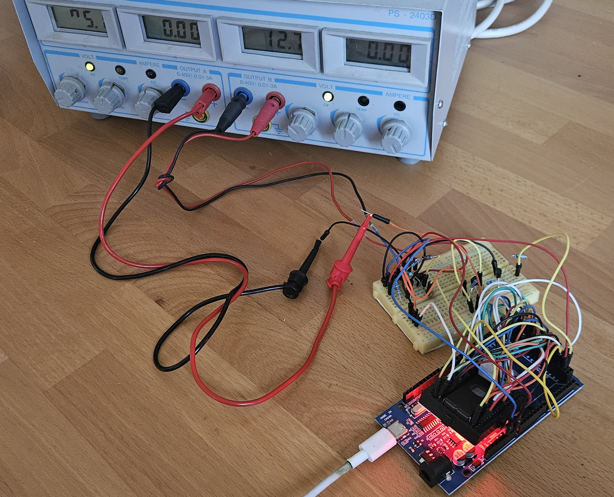
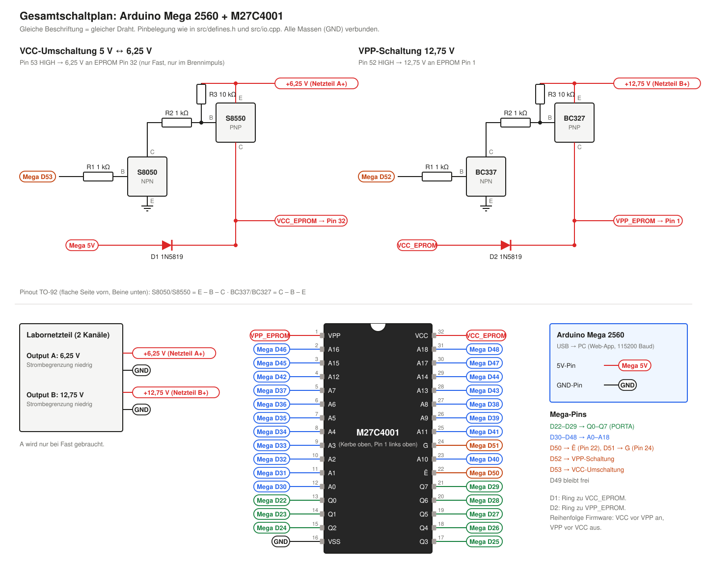
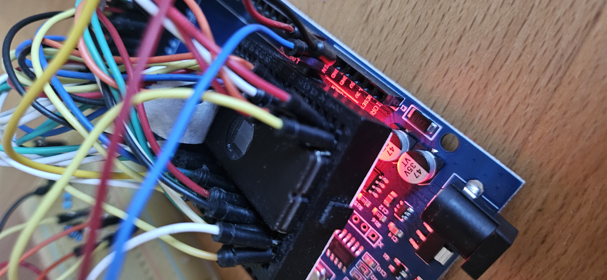
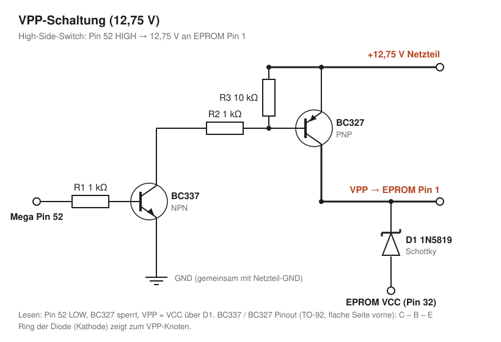
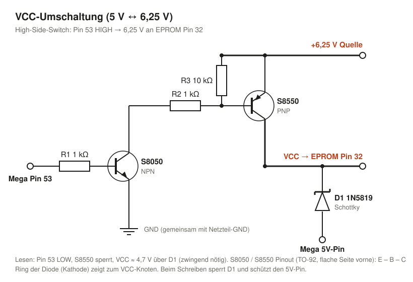
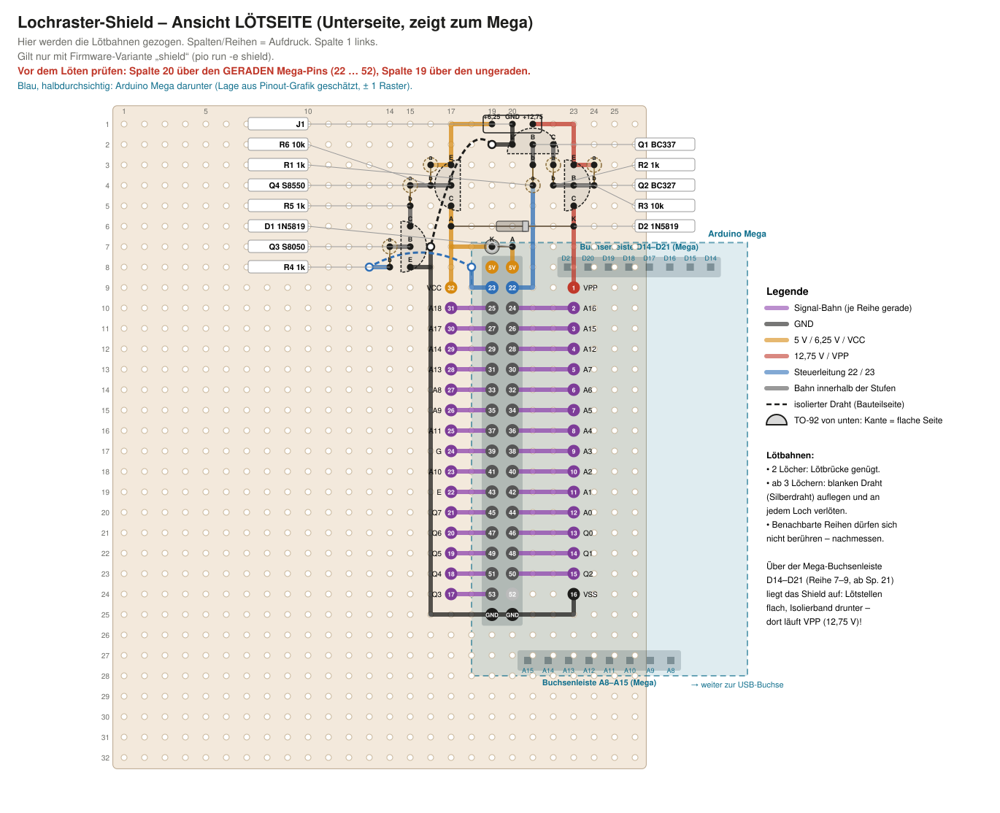
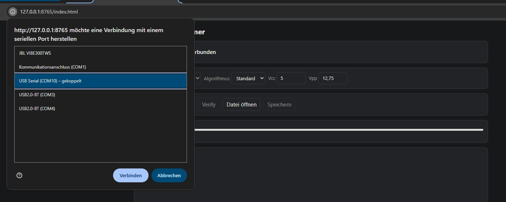
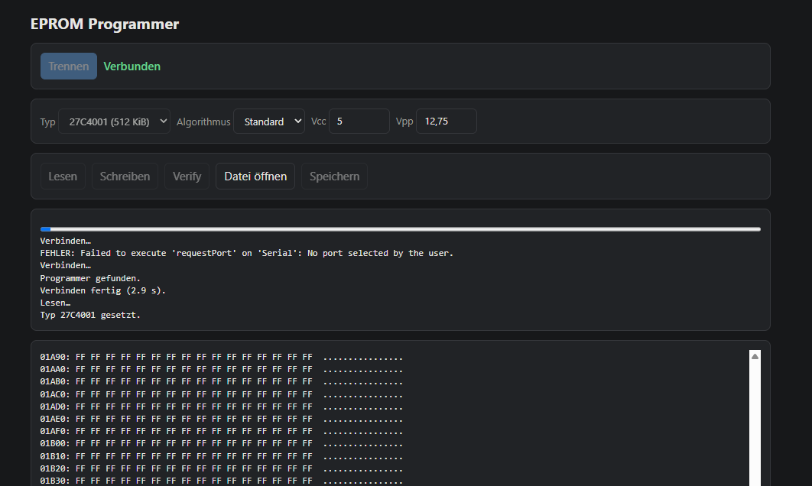
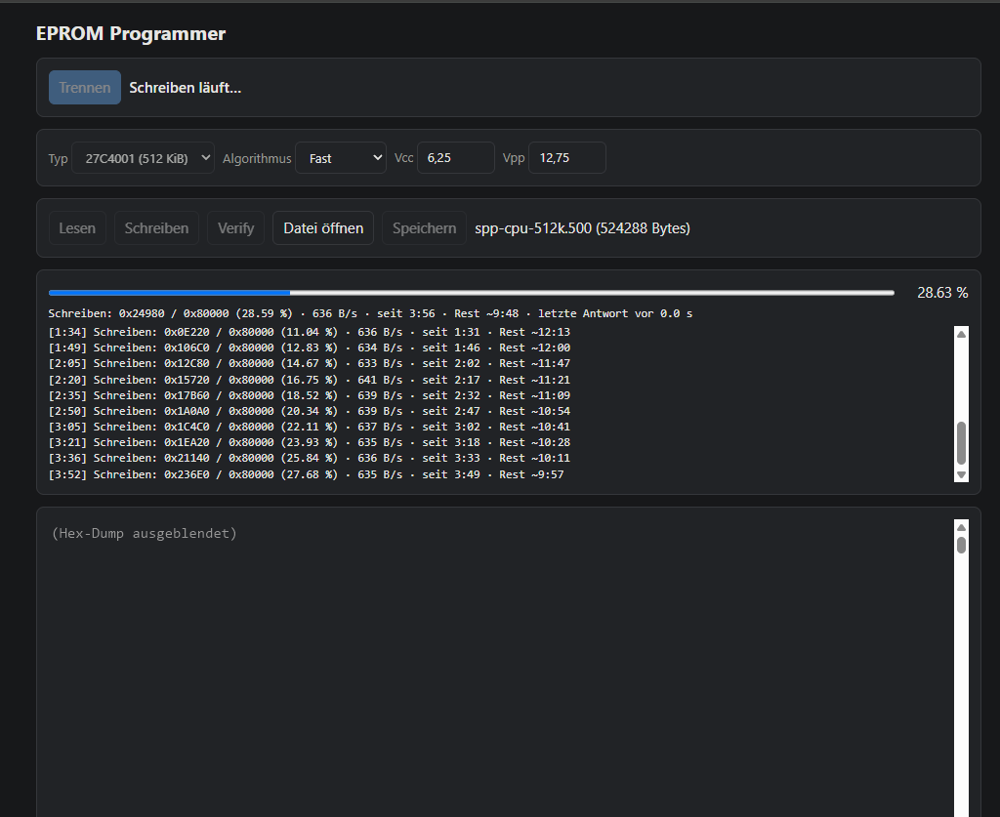

# EPROM Programmer – Arduino Mega + Web-App

UV-EPROMs (getestet mit **ST M27C4001**) auslesen und beschreiben mit einem **Arduino Mega 2560**, direkt verdrahtet ohne Schieberegister. Bedient wird das Ganze über eine **Web-App im Browser** (Chrome/Edge, Web Serial API) – direkt unter Windows, ohne WSL oder Treiber-Umwege.

Anwendungsbeispiel: das CPU-Game-ROM eines Flippers **The Simpsons Pinball Party (Stern, 2003, Whitestar-System)** auf einen M27C4001 brennen – siehe [Beispiel: Simpsons Pinball Party](#9-beispiel-simpsons-pinball-party-stern).



## Stand

| Funktion | Status |
| :--- | :--- |
| Verbinden über Web-App (COM-Port, CH340) | ✅ funktioniert |
| Lesen 27C4001 (512 KiB) inkl. Live-Hex-Dump, Leer-Prüfung | ✅ funktioniert |
| Speichern als `.bin` | ✅ eingebaut |
| Schreiben (Fast) mit Live-Fortschritt | ✅ läuft am Gerät, gemessen ca. 636 B/s (27C4001 ≈ 14 min) |
| Automatisches Verify nach dem Schreiben | ⚠️ eingebaut, kompletter Durchlauf am Gerät noch ausstehend |
| VCC-Umschaltung 5 V ↔ 6,25 V (Pin 53, Shield: Pin 23) | ⚠️ in Betrieb (Fast), Umschaltzeit **noch nicht mit dem Oszi nachgemessen** |
| Spannungsmessung Vcc/Vpp | ❌ nicht vorhanden – die Firmware meldet einfach die angeforderten Werte zurück |
| Lochraster-Shield ([4.8](#48-variante-b-lochraster-shield-zum-aufstecken)) + Firmware-Variante `shield` | ⚠️ entworfen und kompiliert, **noch nicht gebaut und nicht am Gerät getestet** |

## Inhalt

1. [Sicherheit zuerst](#1-sicherheit-zuerst)
2. [Teileliste](#2-teileliste)
3. [Gesamtschaltplan](#3-gesamtschaltplan)
4. [Verdrahtung Schritt für Schritt](#4-verdrahtung-schritt-für-schritt) – Variante A Steckbrett, [Variante B Shield](#48-variante-b-lochraster-shield-zum-aufstecken)
5. [Vor dem ersten Einsetzen: Spannungen prüfen](#5-vor-dem-ersten-einsetzen-spannungen-prüfen)
6. [Firmware flashen](#6-firmware-flashen)
7. [Web-App starten](#7-web-app-starten)
8. [Bedienung: Lesen, Schreiben, Verify](#8-bedienung-lesen-schreiben-verify)
9. [Beispiel: Simpsons Pinball Party (Stern)](#9-beispiel-simpsons-pinball-party-stern)
10. [Unterstützte EPROM-Typen und Grenzen](#10-unterstützte-eprom-typen-und-grenzen)
11. [Projektstruktur, Herkunft, Lizenz](#11-projektstruktur-herkunft-lizenz)

---

## 1. Sicherheit zuerst

Das M27C4001 arbeitet beim **Lesen** mit 5 V, benötigt zum **Schreiben** (Brennen) jedoch:
- **12,75 V ± 0,25 V an Pin 1 (`VPP`)**
- **6,25 V ± 0,25 V an Pin 32 (`VCC`)** – nicht nur 5 V (Datenblatt: „TA = 25°C; VCC = 6,25V ± 0,25V; VPP = 12,75V ± 0,25V“ im Programmiermodus)

**Verbinde NIEMALS 12,75 V oder 6,25 V direkt mit einem Pin des Arduinos!** Das zerstört den Mikrocontroller (ATmega max. ca. 5,5 V). Beide Spannungen laufen ausschließlich über die Transistor-Schaltstufen unten.

**Power-Sequencing (Datenblatt):** VCC gleichzeitig mit oder vor VPP anlegen, beim Abschalten umgekehrt (erst VPP, dann VCC). Die Firmware hält diese Reihenfolge ein.

Datenblatt: https://www.datasheet-pdf.info/entry/M27C4001

---

## 2. Teileliste

| Anzahl | Teil | Wofür |
| :--- | :--- | :--- |
| 1 | Arduino Mega 2560 (z. B. Klon mit CH340) + USB-Kabel | Steuerung |
| 1 | 32-poliger DIP-Sockel (ideal: ZIF-Sockel) | EPROM |
| 1 | Labornetzteil mit **2 einstellbaren Kanälen** (z. B. PS-2403D) – oder 12,75-V-Netzteil + LM317 auf 6,25 V | Vpp und Programmier-Vcc |
| 1 + 1 | **BC337** (NPN) + **BC327** (PNP) | VPP-Schaltstufe |
| 1 + 1 | **S8050** (NPN) + **S8550** (PNP) | VCC-Schaltstufe |
| 4 | Widerstand 1 kΩ | je 2 pro Schaltstufe |
| 2 | Widerstand 10 kΩ | Pull-up je Schaltstufe |
| 2 | Schottky-Diode **1N5819** | D1 (5 V → VCC), D2 (VCC → VPP) |
| – | Breadboard, Steckbrücken | Aufbau (Variante A) |
| – | statt Breadboard: Lochrasterplatine (Einzelpunkte), Stiftleiste 2×18 (oder 2 × 1×18, Stapelleiste geht auch), 2 Buchsenleisten 1×16, 3-polige Stiftleiste, Silberdraht | Shield (Variante B, [4.8](#48-variante-b-lochraster-shield-zum-aufstecken)) |
| – | UV-Löschgerät | Fenster-EPROMs löschen |

Die zwei Transistorpaare haben **unterschiedliche Pinouts** (TO-92, flache Seite zu dir, Beine unten, links→rechts):
- BC337 / BC327: **C – B – E**
- S8050 / S8550: **E – B – C**

---

## 3. Gesamtschaltplan

Alles auf einen Blick – inklusive EPROM-Sockel, beider Schaltstufen und Netzteil. **Gleiche Beschriftung = gleicher Draht**, alle GND sind miteinander verbunden.



Pinout des Chips (Herstellerbezeichnungen):




---

## 4. Verdrahtung Schritt für Schritt

Es gibt zwei Aufbau-Varianten mit **unterschiedlicher Pinbelegung** – Firmware und Verdrahtung müssen zusammenpassen:

| Variante | Aufbau | Firmware | Beschrieben in |
| :--- | :--- | :--- | :--- |
| **A – Steckbrett** | EPROM-Sockel + Schaltstufen auf dem Breadboard, Steckbrücken zum Mega | Standard: `pio run -t upload` | 4.1–4.7 |
| **B – Shield** | Lochrasterplatine, direkt auf den Mega gesteckt | `pio run -e shield -t upload` | [4.8](#48-variante-b-lochraster-shield-zum-aufstecken) |

Die Web-App zeigt beim Verbinden, welche Firmware läuft: `Programmer gefunden (Mega Direct)` bzw. `(Mega Direct, Shield)`.

Die Tabellen 4.1–4.4 (Variante A) nennen die physische **EPROM-Pin-Nummer** (1–32), das **Chip-Label** wie im Pinout-Bild (z. B. `VSS`, nicht „GND“) und das Ziel am Mega.

### 4.1 Masse und Versorgung

| EPROM Pin | Chip-Label | Bedeutung | Anschluss |
| :--- | :--- | :--- | :--- |
| 16 | **VSS** | Masse (0 V) | `GND` am Mega |
| 32 | **VCC** | Versorgung: 5 V Lesen / 6,25 V Schreiben | Ausgang der VCC-Schaltstufe + D1 ([4.6](#46-vcc-umschaltung-5-v--625-v)) |
| 1 | **VPP** | Programmierspannung | Ausgang der VPP-Schaltstufe + D2 ([4.5](#45-vpp-schaltstufe-1275-v)) |

**Gemeinsame Masse:** Minus beider Netzteilkanäle mit GND des Mega verbinden.

### 4.2 Daten-Pins (PORTA)

| EPROM Pin | Chip-Label | Arduino Mega Pin |
| :--- | :--- | :--- |
| 13 | **Q0** | Digital `22` |
| 14 | **Q1** | Digital `23` |
| 15 | **Q2** | Digital `24` |
| 17 | **Q3** | Digital `25` |
| 18 | **Q4** | Digital `26` |
| 19 | **Q5** | Digital `27` |
| 20 | **Q6** | Digital `28` |
| 21 | **Q7** | Digital `29` |

### 4.3 Adress-Pins

| EPROM Pin | Chip-Label | Arduino Mega Pin |
| :--- | :--- | :--- |
| 12 | **A0** | Digital `30` |
| 11 | **A1** | Digital `31` |
| 10 | **A2** | Digital `32` |
| 9 | **A3** | Digital `33` |
| 8 | **A4** | Digital `34` |
| 7 | **A5** | Digital `35` |
| 6 | **A6** | Digital `36` |
| 5 | **A7** | Digital `37` |
| 27 | **A8** | Digital `38` |
| 26 | **A9** | Digital `39` |
| 23 | **A10** | Digital `40` |
| 25 | **A11** | Digital `41` |
| 4 | **A12** | Digital `42` |
| 28 | **A13** | Digital `43` |
| 29 | **A14** | Digital `44` |
| 3 | **A15** | Digital `45` |
| 2 | **A16** | Digital `46` |
| 30 | **A17** | Digital `47` |
| 31 | **A18** | Digital `48` |

### 4.4 Steuer-Pins

| EPROM Pin | Chip-Label | Bedeutung | Arduino Mega Pin |
| :--- | :--- | :--- | :--- |
| 22 | **Ē** | Chip Enable (aktiv LOW) | Digital `50` |
| 24 | **Ḡ** | Output Enable (aktiv LOW) | Digital `51` |
| – | *(kein EPROM-Pin)* | VPP_EN → VPP-Schaltstufe | Digital `52` |
| – | *(kein EPROM-Pin)* | VCC_EN → VCC-Schaltstufe | Digital `53` |

Auf dem Chip stehen nur `Ē` und `Ḡ`; „CE“/„OE“ sind die üblichen Namen in Datenblättern. D50–D53 sind am Mega zugleich die SPI-Pins – unproblematisch, solange kein weiteres SPI-Gerät angeschlossen ist. D49 bleibt frei.

### 4.5 VPP-Schaltstufe (12,75 V)

High-Side-Switch (Pinangaben 4.5/4.6 für Variante A; beim Shield VPP_EN = Pin 22, VCC_EN = Pin 23): Pin 52 HIGH → 12,75 V an EPROM Pin 1. BC337/BC327 (45 V / 800 mA) haben bei 12,75 V und max. 50 mA IPP reichlich Reserve.

1. Arduino **Pin 52** über **1 kΩ** an die **Basis** des **BC337**.
2. **Emitter** des BC337 an **GND**.
3. **Kollektor** des BC337 über **1 kΩ** an die **Basis** des **BC327**.
4. **Emitter** des BC327 an **+12,75 V** (Netzteil B+).
5. **10 kΩ** zwischen Emitter (12,75 V) und Basis des BC327 – hält ihn im Ruhezustand sicher aus.
6. **Kollektor** des BC327 an **EPROM Pin 1 (VPP)**.
7. **D2 (1N5819):** Anode an **EPROM Pin 32 (VCC)**, Kathode (Ring) an **EPROM Pin 1 (VPP)**.

**Warum D2?** Beim Lesen muss VPP = VCC sein. Die Diode liefert das; beim Brennen sperrt sie und schützt den Rest der Schaltung. Schottky statt 1N4148/1N4007, weil deren 0,6–0,7 V Abfall VPP beim Lesen auf ca. 4,3 V drücken würde. D2 geht vom **VCC-Pin des EPROMs** ab, nicht vom 5-V-Pin des Mega – so folgt VPP dem aktuellen VCC.



### 4.6 VCC-Umschaltung (5 V ↔ 6,25 V)

Gleiches Prinzip mit S8050/S8550 (anderes Pinout als BC337/BC327, siehe [Teileliste](#2-teileliste)). Pin 53 HIGH → 6,25 V an EPROM Pin 32.

1. Arduino **Pin 53** über **1 kΩ** an die **Basis** des **S8050**.
2. **Emitter** des S8050 an **GND**.
3. **Kollektor** des S8050 über **1 kΩ** an die **Basis** des **S8550**.
4. **Emitter** des S8550 an **+6,25 V** (Netzteil A+).
5. **10 kΩ** zwischen 6,25 V und Basis des S8550.
6. **Kollektor** des S8550 an **EPROM Pin 32 (VCC)**.
7. ⚠️ **D1 (1N5819), zwingend:** Anode an den **5-V-Pin des Mega**, Kathode (Ring) an **EPROM Pin 32 (VCC)**.

**Warum D1?** Solange Pin 53 LOW ist, sperrt der S8550. Ohne D1 hätte das EPROM beim Lesen 0 V und liefert nur `00`. Mit D1 bekommt es ca. 4,7 V. Beim Brennen sperrt D1, damit die 6,25 V nicht in den 5-V-Pin des Mega zurückfließen.

**Was die Firmware macht:** Nur beim **Fast**-Algorithmus (Web-App fordert Vcc > 5,5 V an) schaltet sie Pin 53 für jeden Brennimpuls: VCC hoch → VPP an → Impuls → VPP aus → VCC zurück auf 5 V → Verify. Das Verify läuft bei 5 V, damit das EPROM die Datenleitungen nicht mit 6,25 V in die Mega-Pins treibt. Die Einschwingzeit `VCC_SETTLE_US` (500 µs, `src/defines.h`) ist geschätzt – am Oszi nachmessen. **Standard** bleibt immer bei 5 V.



### 4.7 Ersatz-Transistoren

Falls BC337/BC327 oder S8050/S8550 ersetzt werden müssen – **Pinout immer vor dem Einbauen prüfen**:

| Typ | Polarität | TO-92 Pinout (flache Seite zu dir, Beine unten, links→rechts) |
| :--- | :--- | :--- |
| 2N3904 | NPN | E – B – C |
| 2N2222 | NPN | E – B – C |
| C1815 | NPN | E – C – B |
| A1015 | PNP | E – C – B |
| 2N2907 | PNP | E – B – C |
| 2N3906 | PNP | E – B – C |

C1815/A1015 können nur 150 mA – für diese Schaltung (wenige mA) reicht das.

### 4.8 Variante B: Lochraster-Shield zum Aufstecken

Alles auf einer Lochrasterplatine (Einzel-Lötpunkte), die direkt auf die **doppelte Stiftleiste 22–53** des Mega gesteckt wird. Auf dieser Leiste liegen auch 5 V und GND – andere Mega-Pins werden nicht gebraucht. Die Mega-Stiftleiste sitzt **in der Mitte**, links und rechts davon je eine Buchsenleiste 1×16 als EPROM-Sockel (6 Löcher = 15,24 mm Abstand). Jeder EPROM-Pin liegt in **derselben Reihe** wie sein Mega-Pin, die Verbindung ist eine gerade Lötbahn von 2–3 Löchern. Dafür ist die Pinbelegung eine andere als bei Variante A → **Firmware-Variante `shield`** nötig.



**Koordinaten** = Spalten-/Reihennummern, wie sie auf der Platine aufgedruckt sind (Spalten 1 … 26 oben, Reihen 1 … 31 am Anschlussfeld links), **Ansicht auf die Lötseite**. Von der Bauteilseite ist alles spiegelverkehrt. Belegt werden nur Spalte 14–24 und Reihe 1–25; der Rest kann abgesägt werden. Spalte 1 hängt am Anschlussfeld der Platine – nicht benutzen.

> ⚠️ **Vor dem Verlöten prüfen (Annahme, nicht nachgemessen):** Die Belegung geht davon aus, dass am Mega die **geraden Pins (22, 24 … 52) in der inneren Reihe** der Doppelleiste liegen (zur Platinenmitte) und 5 V oben, GND unten. Stiftleiste einstecken, Platine aufsetzen und am Aufdruck des Mega nachsehen: **Spalte 20 muss über den geraden, Spalte 19 über den ungeraden Pins liegen.** Wenn nicht: nicht löten, Plan wird gespiegelt.

**Mega-Leiste und EPROM, Reihe für Reihe** (je Reihe: Sockel links ↔ Mega links, Mega rechts ↔ Sockel rechts):

| Reihe | Sockel links (Sp. 17) | Mega links (Sp. 19) | Mega rechts (Sp. 20) | Sockel rechts (Sp. 23) |
| :--- | :--- | :--- | :--- | :--- |
| 8 | – | 5V | 5V | – |
| 9 | Pin 32 VCC | `23` VCC_EN | `22` VPP_EN | Pin 1 VPP |
| 10 | Pin 31 A18 | `25` | `24` | Pin 2 A16 |
| 11 | Pin 30 A17 | `27` | `26` | Pin 3 A15 |
| 12 | Pin 29 A14 | `29` | `28` | Pin 4 A12 |
| 13 | Pin 28 A13 | `31` | `30` | Pin 5 A7 |
| 14 | Pin 27 A8 | `33` | `32` | Pin 6 A6 |
| 15 | Pin 26 A9 | `35` | `34` | Pin 7 A5 |
| 16 | Pin 25 A11 | `37` | `36` | Pin 8 A4 |
| 17 | Pin 24 G | `39` | `38` | Pin 9 A3 |
| 18 | Pin 23 A10 | `41` | `40` | Pin 10 A2 |
| 19 | Pin 22 E | `43` | `42` | Pin 11 A1 |
| 20 | Pin 21 Q7 | `45` | `44` | Pin 12 A0 |
| 21 | Pin 20 Q6 | `47` | `46` | Pin 13 Q0 |
| 22 | Pin 19 Q5 | `49` | `48` | Pin 14 Q1 |
| 23 | Pin 18 Q4 | `51` | `50` | Pin 15 Q2 |
| 24 | Pin 17 Q3 | `53` | `52` frei | Pin 16 VSS |
| 25 | – | GND | GND | – |

In Reihe 10–23 wird jeder Sockel-Pin mit dem Mega-Pin daneben verbunden (links Sp. 17→19, rechts Sp. 23→20), in Reihe 24 nur links. **Reihe 9 bleibt in der Mitte offen** – VPP, VCC, 22 und 23 gehen zu den Schaltstufen. Pin 16 (VSS) geht nach unten zu GND.

**Bauteile** (Widerstände stehend, D2 liegend über Reihe 6, D1 stehend). Transistoren nach dieser Liste stecken, nicht nach der Lage im Bild – das Pinout steht in [Kap. 2](#2-teileliste):

| Bauteil | Bein → Loch (Sp./R.) |
| :--- | :--- |
| J1 (Netzteil, 3-pol.) | +6,25 V 19/1, GND 20/1, +12,75 V 21/1 |
| Q1 BC337 | E 20/2, B 21/2, C 22/2 |
| R1 1k | 21/3, 21/4 |
| R2 1k | 22/3, 22/4 |
| Q2 BC327 | E 23/3, B 23/4, C 23/5 |
| R3 10k | 24/3, 24/4 |
| D2 1N5819 | A 17/6, K (Ring) 23/6 |
| D1 1N5819 | K (Ring) 19/7, A 20/7 |
| Q4 S8550 | E 17/3, B 17/4, C 17/5 |
| R6 10k | 16/3, 16/4 |
| R5 1k | 15/4, 15/5 |
| Q3 S8050 | C 15/6, B 15/7, E 15/8 |
| R4 1k | 14/7, 14/8 |

**Lötbahnen der Stromversorgung und Schaltstufen** (Loch für Loch geradeaus bzw. um die Ecke, wie im Bild):

| Netz | Lötbahn |
| :--- | :--- |
| GND | 23/24 (Pin 16) → 23/25 → 16/25 → hoch bis 16/7, dazu 16/8 → 15/8 (Q3 E) |
| GND | 19/2 → 20/2 → 20/1 (Q1 E an J1 GND) |
| 5 V | 20/8 → 20/7 (D1 A) |
| VCC (Pin 32) | 17/9 → 17/5 (D2 A, Q4 C), dazu 19/7 → 17/7 (D1 K) |
| VPP (Pin 1) | 23/9 → 23/5 (D2 K, Q2 C) |
| VPP_EN (Mega 22) | 20/9 → 21/9 → hoch bis 21/4 (R1) |
| Q1 Basis | 21/3 → 21/2 |
| Q1 Kollektor | 22/2 → 22/3 |
| Q2 Basis | 22/4 → 23/4 → 24/4 |
| +12,75 V | 21/1 → 23/1 → 23/3 → 24/3 |
| VCC_EN (Mega 23) | 19/9 → 18/9 → 18/8 |
| Q3 Basis | 14/7 → 15/7 |
| Q3 Kollektor | 15/6 → 15/5 |
| Q4 Basis | 15/4 → 16/4 → 17/4 |
| +6,25 V | 19/1 → 17/1 → 17/3 → 16/3 |

**Zwei isolierte Drahtbrücken** auf der Bauteilseite: **GND** 19/2 → 16/7 und **VCC_EN** 18/8 → 14/8.

**Montage:**
- Mega-Stiftleiste von der Bauteilseite einstecken, Kunststoff oben, lange Stifte nach unten zum Mega, auf der Lötseite verlöten. Erst danach die Bahnen ziehen.
- Die Platine ragt in Richtung Spalte 1 über das Ende des Mega hinaus, der Bereich ab Spalte 21 liegt über dem Mega. Unterseite dort mit Isolierband abdecken.
- Kerbe des EPROMs zeigt zu Reihe 1 (zu J1).
- Die Belegung erzeugt `images/lochraster_shield.svg`. Das Skript prüft beim Erzeugen, dass jedes Loch genau ein Netz hat und jedes Netz verbunden ist – am fertigen Board trotzdem mit dem Durchgangsprüfer gegenmessen (benachbarte Reihen dürfen keinen Durchgang haben).

---

## 5. Vor dem ersten Einsetzen: Spannungen prüfen

Empfehlung, **ohne EPROM im Sockel**, mit dem Multimeter gegen GND:

1. Netzteil: **A = 6,25 V**, **B = 12,75 V**, Strombegrenzung niedrig (z. B. ca. 100 mA).
2. Mega per USB anschließen. Sockel **Pin 32** ≈ 4,7 V (über D1), **Pin 1** ≈ 4,4–4,5 V (über D2).
3. VCC-Stufe testen: den 1-kΩ-Widerstand vor dem S8050 kurz von Pin 53 an den **5-V-Pin** des Mega stecken → Pin 32 ≈ 6,0–6,25 V (nie über 6,5 V). Dabei muss der **5-V-Pin des Mega bei 5 V bleiben** – steigt er, ist D1 falsch herum oder fehlt. Danach zurück an Pin 53.
4. VPP-Stufe genauso mit dem Widerstand vor dem BC337 → Pin 1 ≈ 12,75 V (abzüglich Sättigungsspannung des BC327). Danach zurück an Pin 52.

**Shield (Variante B):** Die Widerstände sind fest verlötet, deshalb das Shield für diesen Test **nicht** auf den Mega stecken. Stattdessen mit Steckbrücken vom Mega versorgen: Mega-5V → Stift `5V`, Mega-GND → Stift `GND`, Netzteil an J1. Dann Sockel Pin 32 ≈ 4,7 V und Pin 1 ≈ 4,4–4,5 V. Für die VCC-Stufe Stift `23` kurz an 5 V legen → Pin 32 ≈ 6,0–6,25 V, für die VPP-Stufe Stift `22` an 5 V → Pin 1 ≈ 12,75 V. Die Stifte 22/23 sind dabei mit nichts sonst verbunden, das ist ungefährlich. Zusätzlich mit dem Durchgangsprüfer: benachbarte Reihen der Leisten untereinander ohne Durchgang.

---

## 6. Firmware flashen

Die Firmware liegt in `src/` und wird mit [PlatformIO](https://platformio.org/) gebaut. `platformio.ini` hat zwei Umgebungen – **die zur Verdrahtung passende flashen**:

| Umgebung | Aufbau | Startmeldung |
| :--- | :--- | :--- |
| `megaatmega2560` (Standard) | Variante A, Steckbrett (4.1–4.7) | `27[C]XXXX programmer (Mega Direct)` |
| `shield` | Variante B, Lochraster-Shield (4.8) | `27[C]XXXX programmer (Mega Direct, Shield)` |

```bash
pio run -t upload --upload-port COM10              # Variante A (Steckbrett)
pio run -e shield -t upload --upload-port COM10    # Variante B (Shield)
```

Vorher die Verbindung in der Web-App trennen – der COM-Port kann nur von einem Programm gleichzeitig genutzt werden. Die Firmware meldet sich mit 115200 Baud; die Web-App zeigt die Variante beim Verbinden im Log an.

Unterschied der Varianten: nur die Pinbelegung (`src/defines.h`, `#ifdef SHIELD`). Beim Shield liegen die Datenleitungen nicht mehr auf einem Port und werden einzeln geschaltet – das kostet pro Byte einige µs, gegenüber ca. 1,5 ms pro Byte beim Schreiben nicht spürbar (geschätzt, nicht gemessen).

---

## 7. Web-App starten

Die Bedienung läuft direkt im Browser über die **Web Serial API** – nur Chrome oder Edge, keine Installation außer Python.

**Windows:** `start-webapp.bat` doppelklicken. Startet den lokalen Webserver und öffnet die App in Chrome (sonst Edge). Fenster schließen = Server beenden.

**Manuell:**

```bash
cd web
python -m http.server 8765 --bind 127.0.0.1
```

Dann `http://127.0.0.1:8765/index.html` öffnen. (Web Serial braucht `localhost`/`127.0.0.1` oder HTTPS.)

---

## 8. Bedienung: Lesen, Schreiben, Verify

1. **Verbinden** klicken und den Port des Arduino wählen (z. B. `USB-SERIAL CH340 (COM10)`). Der Mega wird dabei neu gestartet, die App wartet auf die Meldung `27[C]XXXX programmer`.

   
2. **Typ** des EPROMs wählen (z. B. 27C4001). Algorithmus, Vcc und Vpp werden aus der Typ-Tabelle vorbelegt und können angepasst werden.
3. **Lesen** – der Inhalt erscheint als Hex-Dump. Danach wird angezeigt, ob das EPROM leer ist (alles `FF`). **Speichern** legt den Inhalt als `.bin` ab.

   
4. **Datei öffnen** (`.bin`) – ist die Datei kleiner als das EPROM, wird der Rest mit `FF` aufgefüllt.
5. **Schreiben** – Algorithmus **Fast** wählen (beim 27C4001: Vcc 6,25 V, Vpp 12,75 V). Die App brennt blockweise (32 Byte) und liest danach automatisch zur Kontrolle zurück. Bereits richtige Bytes und `FF`-Bytes werden übersprungen – ein abgebrochener Schreibvorgang kann einfach neu gestartet werden.

   Während des Schreibens zeigt die App unter dem Balken eine Live-Zeile mit Adresse, Prozent, Tempo (B/s), Laufzeit, geschätzter Restzeit und **„letzte Antwort vor X s“**. Die Firmware meldet sich nach jedem Block; kommt länger als 5 s nichts, wird die Zeile rot („keine Antwort vom Programmer“). Alle 15 s landet eine Fortschrittszeile im Log, bei einem Fehler zusätzlich die letzten 40 Serial-Ereignisse.

   
6. **Verify** – vergleicht das EPROM mit der geladenen Datei und meldet die erste Abweichung.

Nur ein Programm kann den COM-Port gleichzeitig nutzen (Arduino-IDE-Monitor, PlatformIO-Monitor usw. vorher schließen).

### Hinweise

* **Fast vs. Standard:** Fast (110-µs-Impulse, Vcc 6,25 V) schafft gemessen ca. 636 B/s. Standard brennt jedes Byte mit mind. 50 ms bei 5 V – ein voller 27C4001 dauert damit rund 7 Stunden. Die App zeigt die Schätzung vor dem Start an.
* Das Feld **Vcc** stellt keine Spannung ein: Ab 5,5 V schaltet die Firmware bei Fast nur Pin 53 (Shield: Pin 23). Die 6,25 V müssen am Netzteil (Kanal A) eingestellt sein.
* Die Firmware misst Vcc/Vpp nicht – die Werte in der App werden nur übertragen.
* Lesen: Die Firmware sendet Hex-Text (`FF FF …`), gemessen ca. 3,3 KB/s – ein 27C4001 braucht rund 2,5–3 Minuten.

---

## 9. Beispiel: Simpsons Pinball Party (Stern)

*The Simpsons Pinball Party* (Stern, 2003) läuft auf dem **Sega/Stern-Whitestar**-System. Das Spielprogramm steckt im **CPU-Game-EPROM U210** auf der CPU/Sound-Platine. Die letzte Version ist **CPU 5.00** (`spp-cpu.500`, 1 Mbit = 128 KiB, Stand 2. Juli 2007). Laut Release-Notes setzt die CPU-Version 4.00 auch Display-ROM 4.00 oder neuer voraus – das Display-ROM also mit aktualisieren.

So wurde es hier gemacht:

1. Das 128-KiB-Image 4× hintereinander zu 512 KiB zusammengesetzt (`spp-cpu-512k.500`), damit es auf einem **M27C4001** unabhängig von den oberen Adressleitungen gleich aussieht:
   ```bash
   cat spp-cpu.500 spp-cpu.500 spp-cpu.500 spp-cpu.500 > spp-cpu-512k.500
   ```
   Windows (cmd): `copy /b spp-cpu.500+spp-cpu.500+spp-cpu.500+spp-cpu.500 spp-cpu-512k.500`
2. Chip mit UV löschen bzw. per **Lesen** prüfen, dass er leer ist.
3. In der Web-App Typ **27C4001**, Algorithmus **Fast** (Vcc 6,25 V, Vpp 12,75 V), Datei öffnen, **Schreiben** – Dauer ca. 14 Minuten plus Verify.

> Nicht geprüft: welche EPROM-Größen der U210-Sockel der Whitestar-Platine ohne Jumperänderung annimmt. Vor dem Einsetzen Platine/Service-Unterlagen prüfen. Alle ICs auf Whitestar-CPU/Sound-Platinen sitzen mit der **Kerbe nach unten** ([PinWiki](https://pinwiki.com/wiki/index.php/Sega/Stern_Whitestar_Repair)).

### 27C4001 (verwendet) oder 27C1001 (passende Größe)

Hier wurde ein **M27C4001** (4 Mbit) gebrannt, weil er vorhanden war. Das Image hat aber nur 1 Mbit – der U210-Platz ist laut Release-Notes ein **1M**-Platz. Ein **27C1001 / 27C010** (1 Mbit, ebenfalls 32-polig) wäre daher die passendere Wahl:

| | 27C4001 (verwendet) | 27C1001 |
| :--- | :--- | :--- |
| Image | 4× gespiegelt (`spp-cpu-512k.500`) | Original `spp-cpu.500` direkt |
| Brennzeit Fast | ca. 14 min | ca. 3–4 min (¼ der Daten, geschätzt) |
| Pin 30 | A17 | NC (nicht verbunden) |
| Pin 31 | A18 | **P** (Program-Strobe, aktiv LOW) |
| Brennimpuls | auf **Ē** (Pin 22), Ḡ HIGH | auf **P** (Pin 31), Ē LOW, Ḡ HIGH |
| Verify | Ē, Ḡ LOW | Ē, Ḡ LOW, **P HIGH** |
| Vcc / Vpp beim Brennen | 6,25 V / 12,75 V | 6,25 V / 12,75 V |

Pins 1–29 und 32 sind gleich belegt, die Verdrahtung bleibt also. Was **minimal anders** gemacht werden muss:

1. **Firmware:** Pin 31 hängt an Mega `D48` (Shield: `D25`; beim 4001 = A18). Für den 27C1001 muss die Firmware D48 als **P** behandeln: im Ruhezustand HIGH, für den Brennimpuls LOW pulsen, Ē dabei dauerhaft LOW. Das ist **noch nicht umgesetzt** – die aktuelle Firmware pulst Ē und hält D48 bei Adressen unter 128 KiB auf LOW.
2. **Web-App:** Typ **27C1001** wählen, Algorithmus Fast. Die Typ-Tabelle setzt Vcc dort auf 5 V – von Hand auf **6,25 V** stellen, sonst schaltet die Firmware Pin 53 (Shield: 23) nicht.
3. **Datei:** `spp-cpu.500` direkt öffnen, kein Zusammensetzen nötig.

> Pin-Belegung und Betriebsarten des 27C1001 stammen aus Datenblatt-Auszügen (ST M27C1001). Vor dem Umbau die Tabelle „Operating Modes“ und Figure 2 im Original-Datenblatt prüfen.

Quellen: [M27C1001 Datenblatt (ST)](https://www.komponenten.es.aau.dk/fileadmin/komponenten/Data_Sheet/Memory/M27C1001.pdf), [PinWiki – Sega/Stern Whitestar Repair](https://pinwiki.com/wiki/index.php/Sega/Stern_Whitestar_Repair), [Pinside – TSPP Versionen/U210](https://pinside.com/pinball/forum/topic/tspp-another-noob-question-sorry).

---

## 10. Unterstützte EPROM-Typen und Grenzen

Die Web-App bietet alle Typen der Firmware an (jeweils die „Generic“-Werte für Vpp/Vcc, von Hand änderbar): 2716, 27C16, 2732, 27C32, 2764, 27C64, 27128, 27C128, 27256, 27C256, 27512, 27C512, 27C010, 27C1001, 27C020, 27C2001, 27C040, 27C4001, 27C080.

* Die Verdrahtung ist für 32-polige Chips mit dem Pinout des **M27C4001 / 27C040** gemacht. 24- und 28-polige Typen (2716 … 27512) haben ein anderes Pinout und brauchen eine eigene Verdrahtung – ungetestet.
* Es sind nur A0–A18 verdrahtet (max. 512 KiB). Der **27C080 (1 MiB)** braucht A19 und wird nicht vollständig gelesen/geschrieben.


---

## 11. Projektstruktur, Herkunft, Lizenz

| Ordner / Datei | Inhalt |
| :--- | :--- |
| `src/` | Firmware für den Arduino Mega (PlatformIO) |
| `web/` | Web-App (`index.html`, eine Datei, keine Abhängigkeiten) |
| `start-webapp.bat` | Startet Webserver + Browser unter Windows |
| `images/` | Fotos, Pinout und Schaltpläne |
| `tools/lochraster_shield.py` | Erzeugt und prüft den Shield-Plan (`images/lochraster_shield.svg`) |

Basiert auf dem EpromProgrammer von Ciprian Stingu (Arduino Nano + Schieberegister + Linux-Qt-GUI). Die Linux-GUI, das Nano-PCB und das Gehäuse wurden entfernt; sie sind in der Git-Historie vor diesem Umbau noch enthalten.

Lizenz: GPL v2, siehe [LICENSE](LICENSE).
