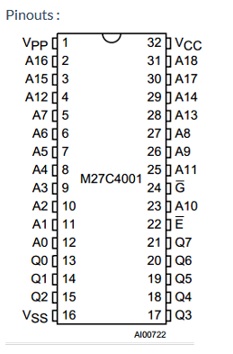
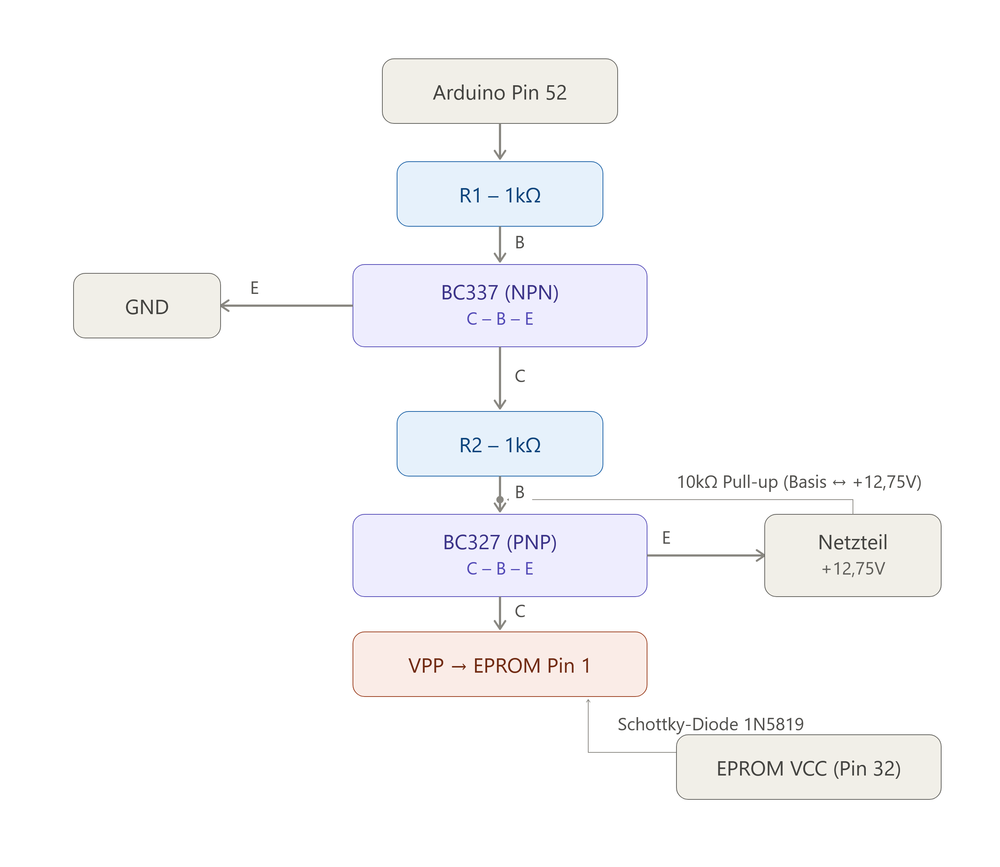
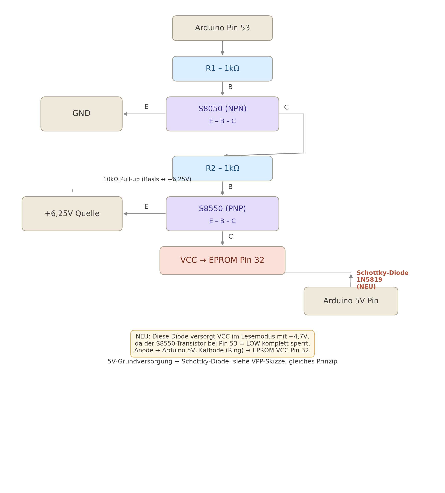
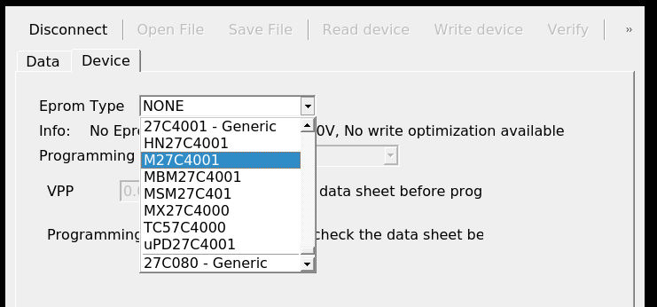

# EpromProgrammer
2716 through 27080 Eprom Programmer

A programmer for EPROMs with capacities between 2KiB (2716 series) and 1MiB (27C080 series).  
It uses an Arduino NANO and few other components.  
As a starting point I used the excelent [arduino_eprom27_programmer](https://github.com/walhi/arduino_eprom27_programmer) project

## Main features
* It supports a large number of EPROMs with different capacities
* 2 programming speeds (normal & fast). Fast programming speed is available if you configure the VCC correctly
* On fast programming alghoritm, writing a 27C040 EPROM takes around 290 seconds
* Error detection on writing
* Additional verify option

## Hardware
All the files which you need in order to create the PCBs are in the [hardware](hardware) folder.

## Case
The files for 3D printing a case are available in [FreeCAD](FreeCAD) folder

## Limitations in current implementation
* No Windows support, but it should be easy to implement

## Supported EPROMs
```
//------------- 2716 -------------
2716 - Generic, 2716 - AMD, ET2716, HN462716, 2716 - Intel, M2716, M5L2716K, MBM2716, MCM2716, uPD2716
//------------- 27C16 -------------
27C16 - Generic, 27C16 - National, AM2716B, NMC27C16B
//------------- 2732 -------------
2732 - Generic, AM2732, AM9732, F2732, HN462732, 2732A, M2732A, MBM2732, NTE2732A, TMM2732D, uPD2732A
//------------- 27C32 -------------
27C32 - Generic, AM2732B, NMC27C32B, WS57C43C
//------------- 2764 -------------
2764 - Generic, 2764A - Intel, M2764A, M5L2764K, NTE2764, TMM2764AD
//------------- 27C64 -------------
27C64 - Generic, 27C64 - Microchip, Cy7C266, MBM27C64, NMC27C64, TMS27C64
//------------- 27128 -------------
27128 - Generic, HN4827128G, HN27128, M27128A - Intel, M27128A - ST, M5L27128K, M5M27C128K, MBM27128, NTE21128, TMM27128AD, TMS27128, uPD27128
//------------- 27C128 -------------
27C128 - Generic, 27C128 - Microchip, AM27C128, AT27C128, CY27C128, LH57126, M27C128, MSM27C128, NM27C128 - Fairchild, NM27C128 - National, QP27C128, SMJ27C128, TMS27C128
//------------- 27256 -------------
27256 - Generic, A68C256, AT27256, 27256 - Intel, M5L27256K, MBM27256, MSM27256, TMM27256, uPD27256
//------------- 27C256 -------------
27C256 - Generic, 27C256 - Microchip, AM27C256, AM27H256, CXK27C256DQ, CY27C256, CY27H256, CY7C274, EM27C256, FM27C256, HN27C256A, HN27C256AG, IS27C256, M27C256B, M5M27C256K, MBM27C256, 27HC256, MSM27C256H, NM27C256 - Fairchild, NM27C256 - National, NM27LC256, NMC27C256, NMC87C257, NPX27C256, QP27C256, 27C256 - SEEQ, M27C256 - SEEQ, SMJ27C256 - ASI, SMJ27C256 - TI, SPM27C256, TC57256, TMS27C256, TMS87C257, uPD27C256
//------------- 27512 -------------
27512 - Generic, 27512 - Intel, AM27512, HN27512, M27512, M5L27512K, MSM27512, TMM27512AD
//------------- 27C512 -------------
27C512 - Generic, 27C512 - Microchip, 27C512 - Intel, 27C512 - Philips, AM27C512, CXK27C512DQ, CY27C512, CY27H512, EM27C512, FM27C512, HN27C512, IS27HC512, MBM27C512, MX27C512, NM27C512, NM27P512, SMJ27C512 - ASI, SMJ27C512 - TI, TC57512AD, TMS27C512, uPD27C512
//------------- 27C010 -------------
27C010 - Generic, AM27C010, AM27H010, AM27HB010, CY27C010, CY27H010, 27C010 - Intel, EM27C010, FM27C010, HN27C101, IS27C010, M5M27C101K, NM27C010 - Fairchild, NM27C010 - National, NMC27C010, SMJ27C010 - ASI, SMJ27C010 - TI, TMS27C010
//------------- 27C1001 -------------
27C1001 - Generic, CXK27C1001DQ, M27C1001, MBM27C1001, MSM27C1000, MX27C1000, TC57C1001, TC57H1001
//------------- 27C020 -------------
27C020 - Generic, AM27C020, CY27C020, 27C020 - Intel, EM27C020, IS27C020, NM27C020, TMS27C020
//------------- 27C2001 -------------
27C2001 - Generic, M27C2001, MSM27C2000, uPD27C2001
//------------- 27C040 -------------
27C040 - Generic, AM27C040, CY27C040, EM27C040, FM27C040, 27C040 - Intel, NM27C040, NXP27C040, SMJ27C040 - ASI, SMJ27C040 - Micross, SMJ27C040 - TI, TMS27C040
//------------- 27C4001 -------------
27C4001 - Generic, HN27C4001, M27C4001, MBM27C4001, MSM27C401, MX27C4000, TC57C4000, uPD27C4001
//------------- 27C080 -------------
27C080 - Generic, AM27C080, AT27LV080, M27C801, MX27C8000
```

## Programmer images
 

## GUI images
  


# Arduino Mega EPROM Programmer (Direct Wiring)

Dieses Projekt ermöglicht das Auslesen und Beschreiben von UV-EPROMs (speziell **ST M27C4001 / 27C040**) mit einem Arduino Mega 2560.
Durch die hohe Anzahl an Pins am Mega werden **keine Schieberegister** benötigt. Das EPROM wird direkt verkabelt.

Alle Tabellen unten enthalten jetzt drei Spalten, damit keine Verwechslung mehr möglich ist:
- **EPROM Pin** = die physische Pin-Nummer am Gehäuse (1–32, wie im Pinout-Bild eingekreist)
- **Chip-Label** = die Bezeichnung, die exakt so auf dem Pinout-Diagramm des Herstellers steht (z. B. `VSS`, nicht "GND")
- **Bedeutung / Arduino-Pin** = Erklärung bzw. Zielpin am Arduino Mega

## ⚠️ Wichtiger Warnhinweis
Das M27C4001 arbeitet beim **Lesen** mit 5V, benötigt zum **Schreiben** (Brennen) jedoch zwingend:
- **12,75V ± 0,25V an Pin 1 (Chip-Label `VPP`)**
- **6,25V ± 0,25V an Pin 32 (Chip-Label `VCC`)** — nicht nur 5V!

**Verbinde NIEMALS die 12,75V direkt mit einem Pin des Arduinos!** Dies zerstört den Mikrocontroller sofort. Nutze zwingend die unten beschriebene Transistor-Schaltung.

**Power-Sequencing-Regel (laut Datenblatt zwingend einzuhalten):**
> VCC muss gleichzeitig mit oder vor VPP angelegt werden. Beim Abschalten gilt die umgekehrte Reihenfolge: VPP zuerst runter, dann VCC.

D.h. in der Steuerlogik (Sketch) immer: **VCC hoch → dann VPP hoch** beim Start des Schreibens, und **VPP runter → dann VCC runter** beim Beenden. Niemals VPP ohne anliegendes VCC schalten.

Datenblatt: https://www.datasheet-pdf.info/entry/M27C4001

---

## 1. Spannungsversorgung (Power)

| EPROM Pin | Chip-Label | Bedeutung | Anschluss am Arduino Mega / Schaltung |
| :--- | :--- | :--- | :--- |
| 16 | **VSS** | Masse (0V) — *im Pinout-Bild steht `VSS`, nicht "GND"* | `GND` (Masse) |
| 32 | **VCC** | Versorgungsspannung | **Schaltbare Versorgung: 5V zum Lesen / 6,25V ± 0,25V zum Schreiben** (siehe Abschnitt 6) |
| 1 | **VPP** | Programmierspannung | *Geht an den Ausgang der Transistor-Schaltung (siehe Abschnitt 5)* |



> **Hinweis:** Anders als in älteren Bauanleitungen oft angenommen, reicht ein fester 5V-Anschluss an VCC **nicht** aus. Für den Programmiermodus muss VCC auf 6,25V angehoben werden – sonst läuft der Chip außerhalb der Spezifikation und das Programmieren funktioniert nicht zuverlässig (Datenblatt: "TA = 25°C; VCC = 6,25V ± 0,25V; VPP = 12,75V ± 0,25V" im Programmiermodus).

---

## 2. Daten-Pins (PORTA für maximale Geschwindigkeit)

| EPROM Pin | Chip-Label | Arduino Mega Pin |
| :--- | :--- | :--- |
| 13 | **Q0** | Digital `22` |
| 14 | **Q1** | Digital `23` |
| 15 | **Q2** | Digital `24` |
| 17 | **Q3** | Digital `25` |
| 18 | **Q4** | Digital `26` |
| 19 | **Q5** | Digital `27` |
| 20 | **Q6** | Digital `28` |
| 21 | **Q7** | Digital `29` |


---

## 3. Adress-Pins

| EPROM Pin | Chip-Label | Arduino Mega Pin |
| :--- | :--- | :--- |
| 12 | **A0** | Digital `30` |
| 11 | **A1** | Digital `31` |
| 10 | **A2** | Digital `32` |
| 9 | **A3** | Digital `33` |
| 8 | **A4** | Digital `34` |
| 7 | **A5** | Digital `35` |
| 6 | **A6** | Digital `36` |
| 5 | **A7** | Digital `37` |
| 27 | **A8** | Digital `38` |
| 26 | **A9** | Digital `39` |
| 23 | **A10** | Digital `40` |
| 25 | **A11** | Digital `41` |
| 4 | **A12** | Digital `42` |
| 28 | **A13** | Digital `43` |
| 29 | **A14** | Digital `44` |
| 3 | **A15** | Digital `45` |
| 2 | **A16** | Digital `46` |
| 30 | **A17** | Digital `47` |
| 31 | **A18** | Digital `48` |


---

## 4. Steuer-Pins

| EPROM Pin | Chip-Label | Bedeutung | Arduino Mega Pin |
| :--- | :--- | :--- | :--- |
| 22 | **Ē** (im Bild als "E" mit Überstrich) | Chip Enable (Aktiv LOW) | Digital `50` |
| 24 | **Ḡ** (im Bild als "G" mit Überstrich) | Output Enable (Aktiv LOW) | Digital `51` |
| - | *(kein EPROM-Pin, externe Steuerlogik)* | VPP_EN — steuert deine VPP-Transistor-Schaltung | Digital `52` |
| - | *(kein EPROM-Pin, externe Steuerlogik)* | VCC_EN — steuert deine VCC-Umschaltung 5V ↔ 6,25V | Digital `53` |


> **Zur Klarstellung:** Auf dem Chip-Gehäuse selbst sind nur `Ē` (Pin 22) und `Ḡ` (Pin 24) aufgedruckt — "CE" und "OE" sind nur die gebräuchlichen Namen dafür in Datenblättern/Schaltplänen, keine eigenen Chip-Labels. `VPP_EN` und `VCC_EN` sind keine EPROM-Pins, sondern nur die Bezeichnungen, die *du* für die beiden Steuerleitungen zu deinen Transistor-Schaltungen vergibst.

> **Hinweis SPI:** Digital 50–53 sind auf dem Mega gleichzeitig die Hardware-SPI-Pins (MISO/MOSI/SCK/SS). Solange du kein weiteres SPI-Gerät (z. B. SD-Karten-Modul) parallel nutzt, ist das unproblematisch.

---

## 5. Die 12,75V VPP Transistor-Schaltung (High-Side Switch)

Um die 12,75V schnell und sicher ein- und auszuschalten, baust du eine kleine Schaltung auf dem Breadboard auf. Arduino-Pin 52 steuert diese Schaltung.

**Aus deinem vorhandenen Bauteil-Sortiment verwenden wir hier: NPN = `BC337`, PNP = `BC327`.**
Beide sind für bis zu 45V / 800mA spezifiziert — bei nur 12,75V und wenigen mA Laststrom (IPP max. 50mA laut Datenblatt) ist das mehr als ausreichend Reserve.

### Benötigte Bauteile:
* 1x externes DC-Netzteil (exakt **12,75V ± 0,25V**, einstellbar)
* 1x **BC337** (NPN)
* 1x **BC327** (PNP)
* 2x 1kΩ Widerstand
* 1x 10kΩ Widerstand
* 1x Schottky-Diode (z. B. 1N5819) — *statt Standard-Silizium-Diode, siehe Begründung unten*

> **Pinout BC337 / BC327 (TO-92):** Flache Seite zu dir, Beinchen nach unten → von links nach rechts **C – B – E** (Kollektor – Basis – Emitter). Das ist bei beiden identisch, nur die Stromrichtung (NPN vs. PNP) unterscheidet sich. Achtung: Das ist eine andere Pin-Reihenfolge als z. B. bei 2N3904/2N3906 (dort EBC) — beim Verdrahten also nicht verwechseln.

### Aufbau der Schaltung:

1. **Gemeinsame Masse:** Verbinde den Minus-Pol (GND) deines 12,75V-Netzteils zwingend mit dem GND des Arduinos.
2. **Der Steuereingang:** Verbinde Arduino **Pin 52** über einen **1kΩ Widerstand** mit der **Basis (mittleres Bein)** des **BC337**.
3. **NPN Masse:** Verbinde den **Emitter (rechtes Bein)** des **BC337** mit **GND**.
4. **Verbindung der Transistoren:** Verbinde den **Kollektor (linkes Bein)** des **BC337** über den zweiten **1kΩ Widerstand** mit der **Basis (mittleres Bein)** des **BC327**.
5. **Der 12,75V Eingang:** Verbinde den **Emitter (rechtes Bein)** des **BC327** mit dem Plus-Pol (**12,75V**) deines Netzteils.
6. **Pull-Up für Sicherheit:** Setze den **10kΩ Widerstand** zwischen den Emitter (12,75V) und die Basis des **BC327** (hält ihn standardmäßig sicher abgeschaltet).
7. **Der VPP Ausgang:** Der **Kollektor (linkes Bein)** des **BC327** geht direkt an **Pin 1 (Chip-Label `VPP`)** des EPROMs.

### Der Dioden-Trick (Für das Auslesen):
Das EPROM verlangt, dass am VPP-Pin während des reinen Auslesens VPP = VCC anliegt.
* Setze die **Schottky-Diode** so ein, dass der Strom vom **VCC-Pin des EPROMs** zum **VPP-Pin des EPROMs** fließen kann (der Ring/Strich der Diode zeigt zum EPROM-VPP-Pin).
* **Warum Schottky statt Standarddiode?** Eine normale Silizium-Diode (1N4148/1N4007) hat ca. 0,6–0,7V Flussspannung – dann läge VPP beim Lesen nur bei ca. 4,3–4,4V statt der geforderten ~5V (VPP = VCC). Eine Schottky-Diode hat nur ca. 0,2–0,3V Abfall und liegt damit deutlich näher an der Spezifikation.
* **Wichtig:** Die Diode muss vom **VCC-Pin** des EPROMs abgehen, nicht fest vom 5V-Arduino-Pin — da VCC bei dir jetzt schaltbar zwischen 5V und 6,25V ist (siehe Abschnitt 6), folgt VPP beim Lesen automatisch dem aktuellen VCC-Pegel.
* Wenn Arduino Pin 52 auf HIGH schaltet und die vollen 12,75V aus der Transistor-Schaltung auf VPP treiben, sperrt die Diode in Rückwärtsrichtung und schützt den Rest der Schaltung.



---

## 6. Die VCC-Umschaltung (5V ↔ 6,25V)

Damit VCC im Programmiermodus auf 6,25V angehoben werden kann, baust du eine zweite High-Side-Switch-Schaltung auf — nach demselben Prinzip wie die VPP-Schaltung in Abschnitt 5, aber mit einem anderen Transistorpaar aus deinem Bestand, damit du die beiden Schaltungen auf dem Breadboard nicht verwechselst:

**Für die VCC-Schaltung verwenden wir: NPN = `S8050`, PNP = `S8550`.**

> **Pinout S8050 / S8550 (TO-92):** Flache Seite zu dir, Beinchen nach unten → von links nach rechts **E – B – C** (Emitter – Basis – Kollektor). Achtung: Das ist die *umgekehrte* Reihenfolge zu BC337/BC327 (dort CBE) — die beiden Schaltungen sehen auf dem Breadboard also unterschiedlich verdrahtet aus, obwohl sie funktional identisch sind.

### Benötigte Bauteile:
* 1x zweite Spannungsquelle (exakt **6,25V ± 0,25V**, einstellbar)
* 1x **S8050** (NPN)
* 1x **S8550** (PNP)
* 2x 1kΩ Widerstand
* 1x 10kΩ Widerstand
* 1x **zweite Schottky-Diode** (z. B. 1N5819) — *zwingend erforderlich, siehe Punkt 8 unten, sonst bleibt VCC im Lesemodus stromlos!*

### Aufbau:

Du brauchst dafür eine **zweite Spannungsquelle mit 6,25V** (z. B. ein zweites Netzteil oder ein mit LM317 auf 6,25V eingestellter Regler). Das normale 5V des Arduinos bleibt als Standard-VCC bestehen; die 6,25V werden nur während des Programmierens dazugeschaltet.

1. **Gemeinsame Masse:** GND der 6,25V-Quelle mit GND des Arduinos verbinden.
2. **Steuereingang:** Arduino **Pin 53** über einen **1kΩ Widerstand** an die **Basis (mittleres Bein)** des **S8050**.
3. **NPN Masse:** **Emitter (linkes Bein)** des S8050 an GND.
4. **Verbindung:** **Kollektor (rechtes Bein)** des S8050 über einen zweiten **1kΩ Widerstand** an die **Basis (mittleres Bein)** des **S8550**.
5. **6,25V-Eingang:** **Emitter (linkes Bein)** des S8550 an den Plus-Pol der 6,25V-Quelle.
6. **Pull-Up:** **10kΩ Widerstand** zwischen 6,25V-Plus und Basis des S8550 (Schaltung ist im Ruhezustand sicher aus).
7. **Ausgang:** **Kollektor (rechtes Bein)** des S8550 geht auf den **VCC-Pin (Pin 32, Chip-Label `VCC`) des EPROMs**.
8. ⚠️ **5V-Grundversorgung (zwingend erforderlich, nicht optional!):** Verbinde eine **zweite Schottky-Diode** (z. B. 1N5819) zwischen dem 5V-Arduino-Pin und dem VCC-Pin des EPROMs — genau wie beim VPP-Dioden-Trick in Abschnitt 5:
   * **Anode** (Ende ohne Ring) → **5V-Pin des Arduino Mega**
   * **Kathode** (Ende mit Ring) → **Pin 32 (VCC) des EPROMs**, also an denselben Knoten, an dem auch der Kollektor des S8550 ankommt.

> **Warum ist diese Diode nötig?** Solange Arduino-Pin 53 im Lesemodus `LOW` ist, sperrt der PNP-Transistor S8550 komplett — er lässt die 6,25V nicht durch. Ohne diese Diode bekommt Pin 32 des EPROMs beim Lesen **0 Volt**, der Chip ist stromlos und zieht alle Datenleitungen wie ein "totes Bauteil" auf Masse (Auslesen liefert dann nur `00`-Bytes). Mit der Diode fließen im Ruhezustand ca. 4,7V vom Arduino-5V-Pin zum EPROM-VCC — genug zum Lesen. Beim Schreiben schaltet der S8550 die vollen 6,25V auf VCC; die Diode sperrt dann automatisch rückwärts, sodass die 6,25V nicht in den 5V-Pin des Arduinos zurückfließen und ihn beschädigen können.

**Wichtig für die Sequenz:** Dein Sketch muss VCC **immer zuerst** auf 6,25V bringen (Pin 53 HIGH), **bevor** VPP auf 12,75V geschaltet wird (Pin 52 HIGH) — und beim Beenden umgekehrt: erst VPP auf 0 (Pin 52 LOW), dann VCC zurück auf 5V (Pin 53 LOW).



### Restliche Bauteile aus deinem Bestand (Reserve / Alternativen)

Falls du BC337/BC327 oder S8050/S8550 mal ersetzen musst, hier die Pinouts der übrigen Transistoren aus deiner Liste — **Achtung, teils unterschiedliche Pin-Reihenfolge**, immer vor dem Einlöten prüfen:

| Typ | Polarität | TO-92 Pinout (flache Seite zu dir, Beine unten, links→rechts) |
| :--- | :--- | :--- |
| 2N3904 | NPN | E – B – C |
| 2N2222 | NPN | E – B – C |
| C1815 | NPN | E – C – B |
| A1015 | PNP | E – C – B |
| 2N2907 | PNP | E – B – C |
| 2N3908* | PNP | *vermutlich 2N3906 gemeint (EBC) — Aufdruck am Bauteil prüfen, „2N3908" ist keine gängige Standardbezeichnung* |

*C1815/A1015 haben zudem nur max. 150mA Kollektorstrom — für diese Schaltung (wenige mA) trotzdem problemlos ausreichend, aber als Hauptschalter etwas knapper dimensioniert als BC337/BC327.*

---

## Zusammenfassung der Korrekturen gegenüber der ursprünglichen Version

- VPP-Sollwert korrigiert: **12,75V** statt 12,5V (M27C4001-Datenblattwert)
- **VCC muss beim Schreiben auf 6,25V** angehoben werden — vorher fehlte das komplett
- Neuer Pin `53` für **VCC_EN** (Umschaltung 5V/6,25V) ergänzt
- **Power-Sequencing-Regel** ergänzt (VCC vor VPP an, VPP vor VCC aus)
- Standarddiode durch **Schottky-Diode** ersetzt, damit VPP beim Lesen näher an VCC liegt
- Hinweis zu SPI-Pin-Kollision (D50–53) auf dem Mega ergänzt
- Beide High-Side-Switch-Schaltungen (VPP und VCC) auf konkrete vorhandene Bauteile umgestellt: **BC337/BC327** für VPP, **S8050/S8550** für VCC — inkl. korrekter Pinout-Angaben (CBE bzw. EBC), da diese sich unterscheiden
- **Alle Tabellen um eine "Chip-Label"-Spalte ergänzt**, die exakt die Beschriftung aus dem Pinout-Diagramm zeigt (z. B. `VSS` statt "GND" bei Pin 16), damit physische Pin-Nummer und Chip-Beschriftung nicht mehr verwechselt werden können
- ⚠️ **Zweite Schottky-Diode (5V-Arduino-Pin → EPROM VCC Pin 32) als zwingend erforderliches Bauteil ergänzt** — ohne sie ist der EPROM-Chip im Lesemodus komplett stromlos (VCC = 0V, da der S8550 bei Pin 53 = LOW sperrt), wodurch alle Datenleitungen auf Masse gezogen werden und nur Nullen ausgelesen werden. Mit der Diode liegen im Lesemodus ~4,7V an VCC an — der bestätigte Fix, der das Auslesen zum Laufen gebracht hat.

# EpromProgrammer GUI unter Windows (WSL1 & VNC-Browser-Methode)

Diese Anleitung beschreibt, wie die Linux-basierte Qt5-GUI des EpromProgrammers nativ unter Windows ausgeführt werden kann, ohne dass der C++-Code umgeschrieben oder ein externer X-Server (wie XLaunch/VcXsrv) installiert werden muss.

Wir nutzen **WSL1** (Windows Subsystem for Linux) in Kombination mit dem Qt-internen VNC-Server und `noVNC`, um die grafische Oberfläche direkt im Webbrowser (Chrome, Edge, Firefox) anzuzeigen.

---

## 🛠️ 1. Voraussetzungen & Installation

Öffne ein WSL-Terminal (z. B. Ubuntu 20.04 via VS Code) und installiere die benötigten Compiler, Bibliotheken und VNC-Tools:

```bash
sudo apt update
sudo apt install build-essential cmake git
sudo apt install libqt5widgets5 libqt5gui5 libqt5core5a qtwayland5
sudo apt install novnc websockify
```

⚠️ **Wichtiger Bugfix für WSL1 (Ubuntu 20.04):** WSL1 hat ein Problem mit der Komprimierung der Qt5Core-Bibliothek. Damit das Programm startet, muss ein inkompatibler Tag entfernt werden:

```bash
sudo strip --remove-section=.note.ABI-tag /usr/lib/x86_64-linux-gnu/libQt5Core.so.5
```

---

## 🏗️ 2. Kompilieren (Build)

Lade den Code herunter, wechsle in das Verzeichnis und starte den Build-Prozess mit CMake:

```bash
# In den GUI-Ordner wechseln
cd /Pfad/zu/deinem/EpromProgrammer/gui

# Build-Ordner erstellen und vorbereiten
mkdir build
cd build
cmake ..

# Programm kompilieren
make
```

Das ausführbare Programm `EpQt` befindet sich nun im `build`-Ordner.

---

## 🚀 3. Programm starten (Browser-Methode)

Da WSL1 keinen eigenen Monitor hat, lassen wir das Programm als unsichtbaren Server laufen und greifen das Bild über den Browser ab.

### Schritt 1: GUI im VNC-Modus starten (Terminal 1)

Bleibe im `build`-Ordner und starte die GUI als VNC-Server. (Das Terminal bleibt danach scheinbar stehen – das ist korrekt so!)

```bash
./EpQt -platform vnc
```

### Schritt 2: Web-Brücke starten (Terminal 2)

Öffne ein zweites Terminal-Fenster und starte `websockify`. Dieser Dienst übersetzt das VNC-Signal (Port 5900) für deinen Webbrowser (Port 8080):

```bash
websockify --web=/usr/share/novnc/ 8080 localhost:5900
```

### Schritt 3: GUI im Browser öffnen

Öffne in Windows deinen Webbrowser und rufe folgende Adresse auf:

👉 `http://localhost:8080/vnc.html`

Klicke auf **Connect** – die grafische Oberfläche des EpromProgrammers erscheint nun in deinem Browser!

---

## 🔌 4. Arduino / COM-Port verbinden

In WSL1 werden die COM-Ports von Windows exakt 1:1 auf Linux-Ports gemappt:

| Windows | Linux (WSL1) |
|---------|--------------|
| COM1    | `/dev/ttyS1` |
| COM9    | `/dev/ttyS9` |

### COM-Port prüfen (WSL1-Trick)

Da du WSL1 nutzt, hast du direkten Zugriff auf Windows-Befehle. Du kannst dir die aktiven COM-Ports ganz einfach anzeigen lassen, indem du dieses alte DOS-Kommando direkt in dein Linux-Terminal eintippst:

```bash
mode.com
```

Dieser Befehl listet alle aktuell unter Windows aktiven seriellen Schnittstellen auf (z. B. `Status von Gerät COM9:`). Wenn `COM9` dort auftaucht, weißt du sicher, dass er da ist und in Linux als `/dev/ttyS9` angesprochen werden kann.

### Rechte setzen

Falls die GUI beim Verbinden meldet, dass sie keine Berechtigung hat, musst du dem Port einmalig Lese- und Schreibrechte geben (Beispiel für COM9):

```bash
sudo chmod 666 /dev/ttyS9
```

Wähle danach einfach `/dev/ttyS9` in der GUI aus und klicke auf **Connect**. Das Terminal-Log sollte nun `Connected to eprom programmer.` anzeigen.

---

## 🩹 5. Troubleshooting: Programm hängt beim Auslesen (CH340-Problem)

Wenn das Auslesen eines EPROMs mitten im Vorgang stehen bleibt (z. B. hängt der Fortschritt an einer bestimmten Adresse wie `17EC0` und geht einfach nicht mehr weiter), liegt das erfahrungsgemäß **nicht** an der GUI, sondern am Windows-Treiber des CH340-USB-Chips, der auf vielen Arduino-Nano-Klonen verbaut ist.

**Ursache:** Windows legt für den CH340 standardmäßig große FIFO-Puffer an (im Gerätemanager meist auf `High (14)` bzw. `High (16)` voreingestellt). Windows schaufelt dadurch möglichst viele Daten auf einmal in den winzigen Hardware-Zwischenspeicher des Chips. Da WSL1 die Daten aber nicht in Echtzeit schnell genug abholt, läuft dieser Hardware-Puffer voll, und der Chip bricht die Übertragung hart ab — genau das äußert sich als "Hängenbleiben" beim Lesen.

### Lösung: FIFO-Puffer im Windows-Gerätetreiber deaktivieren

1. Öffne den **Windows Gerätemanager**.
2. Suche unter *Anschlüsse (COM & LPT)* den entsprechenden CH340-Port (z. B. `USB-SERIAL CH340 (COM9)`), Rechtsklick → **Eigenschaften**.
3. Wechsle zum Reiter **Anschlusseinstellungen** und klicke dort auf **Erweitert...** (*Advanced...*).
4. Im sich öffnenden Fenster siehst du die Option **Use FIFO buffers** mit zwei Reglern (Receive/Transmit), die standardmäßig auf `High (14)` / `High (16)` stehen.
5. **Nimm den Haken bei "Use FIFO buffers" komplett heraus** — alternativ kannst du testweise stattdessen beide Regler ganz nach links auf `Low (1)` schieben.
6. Klicke in beiden Fenstern auf **OK**, um die Einstellungen zu speichern.
7. Trenne den Arduino kurz vom USB-Port, stecke ihn wieder ein und starte in der GUI einen neuen Leseversuch.

### Falls das Problem trotzdem bestehen bleibt

Sollte WSL1 die rohen Binärdaten danach immer noch blockieren, ist der Windows-Treiber an dieser Stelle ein praktisch unüberwindbarer Flaschenhals. In diesem Fall bleibt als stressfreier Ausweg nur der Umbau der `read.cpp` auf reinen Hex-Text-Output, um das EPROM zuverlässig und vollständig auslesen zu können.


### INFO

